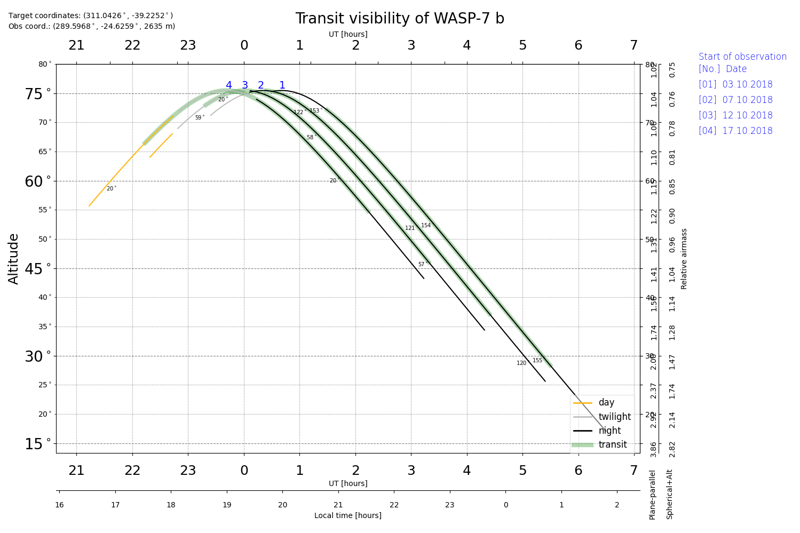

Transit visibility
====================

.. p23ready

.. currentmodule:: PyAstronomy.pyasl

The function :py:func:`transitTimes` provides a table containing, among others,
mid-transit times, altitude above horizon, and Moon distance and phase; i.e., the most relevant
information to evaluate whether a transit is observable at a particular point.

Using :py:func:`transitVisibilityPlot`, the data can be plotted to obtain a
visual impression of the visibility.

Example: Transit observation opportunities for WASP-7 b at Paranal
-------------------------------------------------------------------

Get transit key parameters such as mid-transit time, start and end of observation, altitudes, twilight status,
and moon distance and phase for transits of WASP-7 b for a 100 day range starting in July 2018.
Plot the target altitudes for the windows of opportunity as a function of UT/local time.

Code
~~~~~~

::
        
    from PyAstronomy import pyasl
    import datetime as dt
    
    # Data suitable for WASP-7 b
    wasp_7_data = {
        "plName" : "WASP-7 b",
        "ra" : 302.85206,
        "dec" : -20.35184,
        "T0" : 2455446.63493,
        "orbPer" : 4.9546416,
        "orbInc" : 87.03,
        "SMA" : 0.0617,
        "RpJ" : 1.330,
        "RsSun" : 1.44,
        }
    
    
    # Convert July 14th, 2018, 10pm to a Julian date
    d = dt.datetime(2018, 7, 14, 22)
    jd = pyasl.jdcnv(d)
    
    # Calculate transit data for transits within 100 days starting
    # form July 14th, 2018.
    dat = pyasl.transitTimes(jd, jd+100., wasp_7_data,
                                observatory="esoparanal", obsOffset=1./24.,
                                minAltitude=10.0)
    # Plot the result
    pyasl.transitVisibilityPlot(dat, markTransit=True)

Text output
~~~~~~~~~~~~

::

    Specified time span
    Start date (DDDD-MM-YY and fractional hours): 2018-07-14 22.130
    End date (DDDD-MM-YY and fractional hours): 2018-10-22 22.008
    
    Estimating transit duration using orbital inclination, semi-major axis,
      planetary radius, and stellar radius
    Transit duration: 243.27 minutes
    Off-transit time before and after transit:  60.0  minutes
    
    No. Tmid [HJD]      Obs. start [UT] [ALT, DIR(AZI)]     Transit mid [UT] [ALT, DIR(AZI)]     Obs. end [UT] [ALT, DIR(AZI)]   twilight (SUN ALT)                   moon distance     moon phase
      1 2458394.64668    3.10.  0:29    [ 75°,S(171°)]       3.10.  3:31     [ 51°,W(237°)]       3.10.  6:32  [ 16°,W(233°)]                night (-24°,-57°,-48°)   (153°,154°,155°)   43%
      2 2458399.60132    7.10. 23:24    [ 71°,S(144°)]       8.10.  2:25     [ 59°,W(233°)]       8.10.  5:27  [ 25°,W(236°)]    nautical twilight ( -9°,-47°,-56°)   (123°,121°,119°)    2%
      3 2458404.55597   12.10. 22:18    [ 64°,E(130°)]      13.10.  1:20     [ 67°,S(224°)]      13.10.  4:22  [ 33°,W(238°)]                  day (  5°,-33°,-57°)   ( 60°, 58°, 57°)   18%
      4 2458409.51061   17.10. 21:13    [ 55°,E(124°)]      18.10.  0:15     [ 73°,S(204°)]      18.10.  3:16  [ 42°,W(238°)]                  day ( 20°,-19°,-51°)   ( 20°, 20°, 20°)   63%

Graphical output
~~~~~~~~~~~~~~~~~

The figure shows the product of the `transitVisibilityPlot` function.
In this case, four transits are shown in the form of altitude (or
airmass) as a function of UT and local time. The numbers indicate
to which transit the individual lines refer. The color of the thin
lines indicates the light conditions (e.g., twilight or astronomical night).
The green overlay indicates the time of transit; here, we have one hour of
additional time before and after the transit, which was specified on
the call to `transitTimes`. On the right, you see the dates at which the
*observation* (not necessarily the transit) starts.

API
--------

.. autofunction:: transitTimes

.. autofunction:: transitVisibilityPlot
